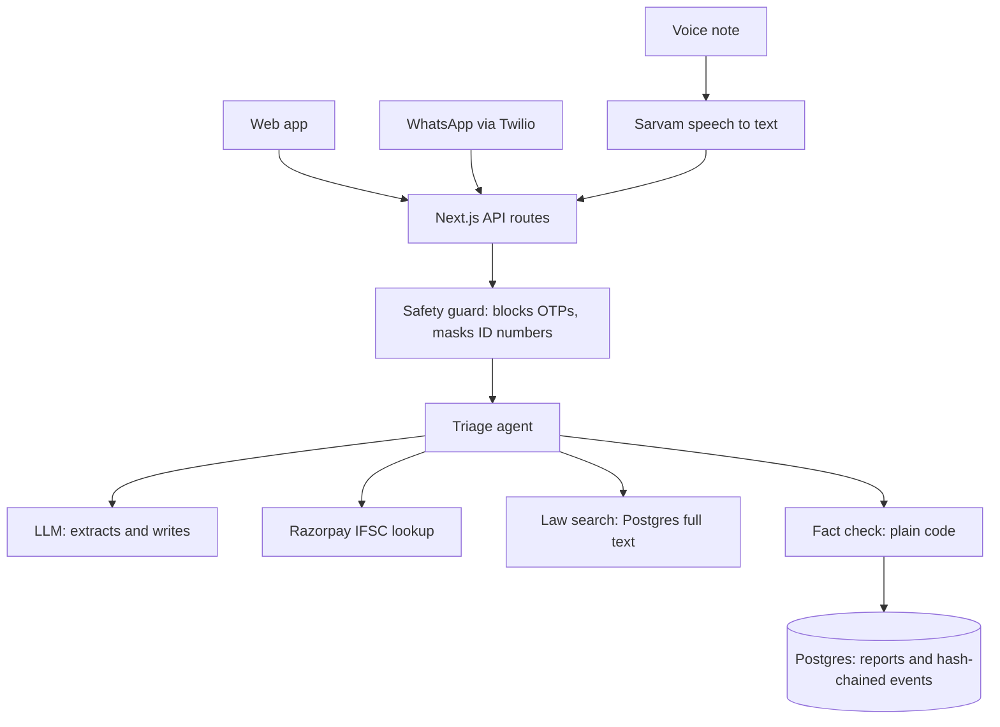

# Saakshya

Saakshya helps Indian cybercrime victims describe what happened by voice or text, prepare a report and see what to do next.

It is an independent project, not a government service. It never files a report for the victim and never promises money back. If money was sent, call **1930** first. Official reporting is at [cybercrime.gov.in](https://cybercrime.gov.in).

**Status: live at https://saakshya-eta.vercel.app.** Reports run end to end on the live database and AI; see [test results](docs/TEST_RESULTS.md). WhatsApp runs on the Twilio sandbox. Voice uses the main AI service.

The feature idea was inspired by [Samarthan](https://samarthan-ai-parichay-s-projects.vercel.app/). No code, name or design is taken from it.

## Architecture



The LLM extracts and writes. Plain code sets priority, validates fields and rejects any draft containing a number the victim did not give. Only law sections returned by the search can be cited.

## Setup

Requires Node 22 or later and a Postgres database.

```bash
npm install
cp .env.example .env.local
npm run db:setup
npm run dev
```

Fill in `.env.local` before running `db:setup`. Check `/api/health` to see which services are connected.

## Tests

```bash
npm test
```

The tests use a stand-in for the LLM and an in-memory Postgres, so they need no keys. They do not prove the live services work.
