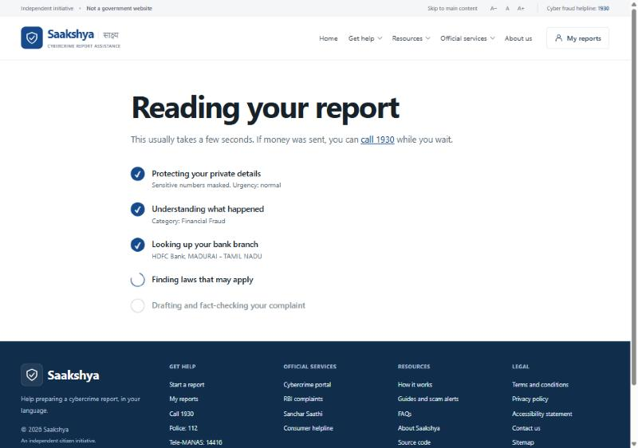
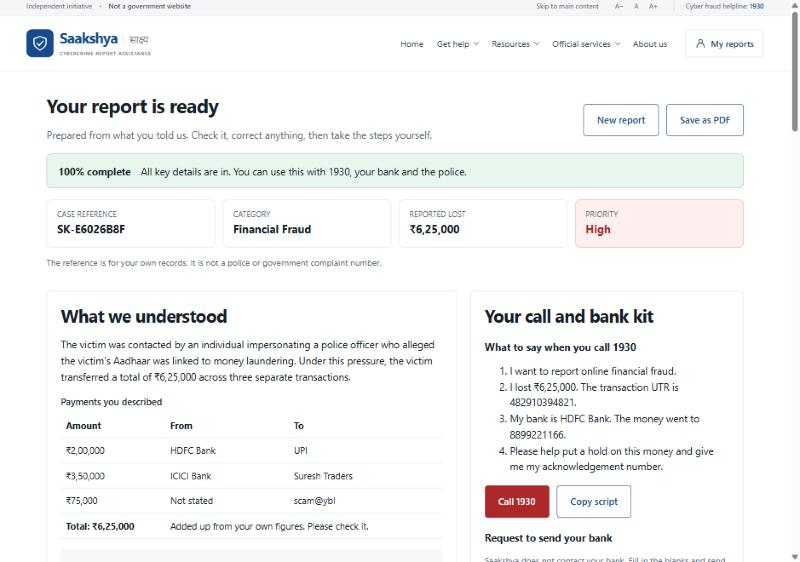
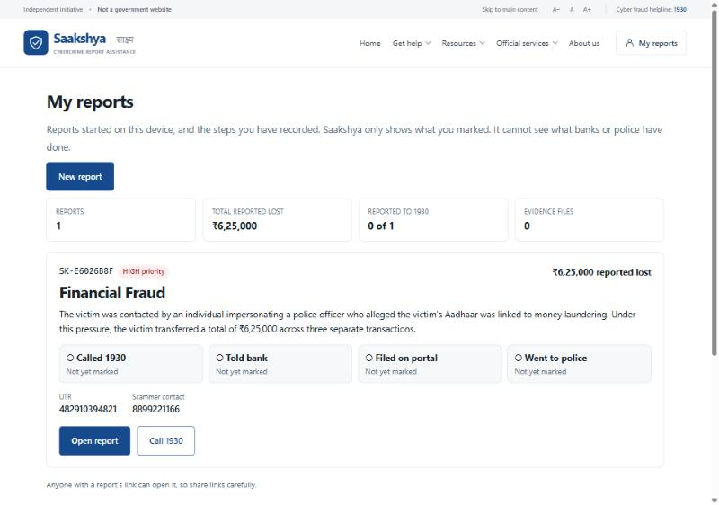
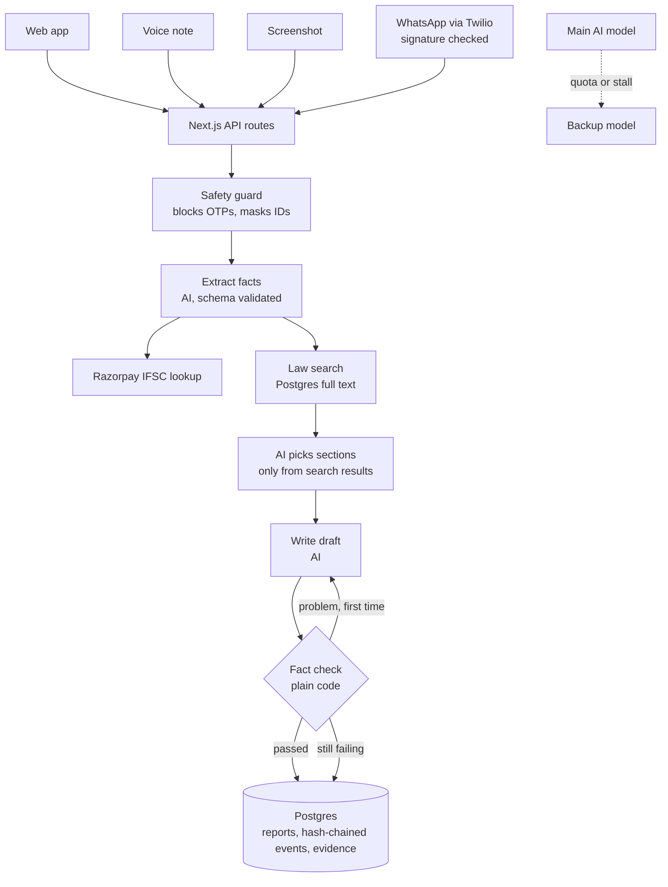

<div align="center">

# Saakshya · साक्ष्य

### Your complaint. In your words.

**An AI agent that turns a cybercrime victim's story, told by voice, text, screenshot or WhatsApp, into a checked complaint draft and clear next steps.**

[](https://github.com/aadityaa0523/saakshya/actions/workflows/checks.yml)


**[Open the live app](https://saakshya-eta.vercel.app)** · [Test results](docs/TEST_RESULTS.md) · [Submission pack](docs/SUBMISSION.md)

Built by team **CONGNIVISTA**: H. Aadityaa (Leader) and Kanak Malpani, for Forge '26, Civic Pulse, Digital Governance and Public Information.

</div>

> [!IMPORTANT]
> **Money sent? Call 1930 first.** Saakshya is an independent project, not a government service. It does not file reports, contact banks or police, or promise money back. Official reporting is at [cybercrime.gov.in](https://cybercrime.gov.in).

## The problem

When someone loses money or is threatened online, they have very little time to act. Many don't know whether to contact 1930, their bank or the police first, or which details matter. Explaining what happened under stress, often in a second language, makes this harder, and fake recovery agents target victims next by asking for OTPs and fees.

## What Saakshya does

| Step | What happens |
|---|---|
| **1. Tell it your way** | Speak, type, attach a screenshot or send a WhatsApp message, in your language |
| **2. Watch the agent work** | Each tick on screen is a real server step, not a timer |
| **3. Check the report** | See the facts found, what is missing, law sections with their wording, and an editable draft |
| **4. Act and keep track** | Use the 1930 script and bank request yourself, then record each step with its date and time |

<table>
<tr>
<td width="33%"><br><sub><b>Live agent steps</b></sub></td>
<td width="33%"><br><sub><b>Checked report and call kit</b></sub></td>
<td width="33%"><br><sub><b>Case dashboard</b></sub></td>
</tr>
</table>

<sub>Screens from the live app, using made-up test stories.</sub>

## Why it is different

- **Checked, not just generated.** Only law sections returned by the search can be cited. Code adds up payment totals. A draft with an invented number is sent back to the AI to fix, and held back if the problem persists.
- **Works where victims already are.** WhatsApp reporting, voice input and 15 languages, with no form to learn.
- **Honest by design.** There are no simulated "bank notified" or "FIR filed" statuses. The app shows only the steps the victim marked as done.
- **Safe for victims.** Labelled OTPs and PINs are refused, ID numbers are masked before the AI sees text, and self-harm language brings up support contacts first.

## Features

| Area | Included |
|---|---|
| **Reporting** | Voice, text, screenshot reading, WhatsApp, 6 complaint groups, 14 scam types with tips |
| **Agent** | Safety guard, fact extraction, live IFSC lookup, law retrieval, drafting, fact check, one self-correction |
| **Report** | Readiness score, payment table, editable details, draft in English and the chosen language |
| **Action kit** | 1930 script, bank request, email opened in the victim's own app, official contacts by crime type |
| **Evidence** | File type checks, SHA-256 fingerprints, hash-chained record, tamper check |
| **Access** | 15 languages, right-to-left Urdu and Sindhi, phone layouts, text-size controls |
| **Privacy** | No account needed, private report links, reports can be deleted |

## Architecture



**The main rule:** the AI reads and writes, while plain code decides what can be trusted. Code sets priority, validates fields, adds totals, restricts citations and checks every number in a draft.

### Built with

| Layer | Technology |
|---|---|
| App | Next.js 15, React 19, TypeScript, deployed on Vercel |
| Database | Postgres on Supabase, full-text search, row-level security, verified TLS |
| AI | Gemini through an OpenAI-compatible API, for text, speech and images, with a backup model |
| Messaging | Twilio WhatsApp sandbox |
| Live data | Razorpay IFSC API |
| Law text | Bharatiya Nyaya Sanhita 2023 and Information Technology Act 2000 |
| Quality | Vitest, in-memory Postgres (PGlite), ESLint, GitHub Actions |

## What happens when things go wrong

| Situation | Response |
|---|---|
| Main AI model hits its quota or stalls | The backup model takes over |
| Draft contains an invented number | Rewritten once with the error fed back, then held back if it persists |
| Law search or drafting fails | The report is still saved, and the draft can be retried |
| AI is completely unavailable | A clear message to call 1930, and the victim's words are kept |
| Connection drops | A plain-language message, and the story is kept in the browser |
| Text includes a labelled OTP or PIN | Refused and not saved |
| Prompt injection in a story or image | Treated as data, and any promised refund is rejected by the fact check |
| Forged WhatsApp request | Rejected with a 403 |
| Wrong report link | Returns "not found", so reports cannot be probed |
| Non-image file renamed as an image | Rejected by checking the file's contents |

## Test results

- **46 automated tests**, run on every push.
- **12 live hard cases** on the deployed site, including pasted OTPs, digital arrest, sextortion, self-harm language, prompt injection, gibberish and multi-bank payments. All pass after fixes, with one note. See [full results and limits](docs/TEST_RESULTS.md).

## Run it locally

You need Node 22 or later, a Postgres database and an OpenAI-compatible AI key.

```bash
git clone https://github.com/aadityaa0523/saakshya.git
cd saakshya
npm install
cp .env.example .env.local
```

Fill in `.env.local`, then:

```bash
npm run db:setup
npm run db:laws
npm run dev
```

Open http://localhost:3000, and check `/api/health` to see which services are connected. The database connection uses the Supabase root certificate in `lib/supabase-ca.mjs`, so replace it for another provider.

| Setting | Purpose | Required |
|---|---|---|
| `DATABASE_URL` | Postgres connection | Yes |
| `LLM_BASE_URL`, `LLM_MODEL`, `LLM_API_KEY` | Main AI service | Yes |
| `LLM_FALLBACK_MODEL` | Backup model | Recommended |
| `TWILIO_ACCOUNT_SID`, `TWILIO_AUTH_TOKEN`, `TWILIO_WHATSAPP_FROM` | WhatsApp | For WhatsApp |
| `APP_URL` | Report links and webhook checks | For WhatsApp |

## Project structure

```text
app/            Pages, plus API routes in app/api
lib/agent.ts    Triage agent, self-correction and fact check
lib/safety.ts   OTP blocking, masking and urgency
lib/chain.ts    Hash-chained record
lib/llm.ts      AI calls and backup model
lib/actions.ts  Readiness, 1930 script and bank request
db/schema.sql   Database tables
scripts/        Database setup, law loading and translation
laws/           Act text
public/i18n/    Site translations
tests/          Automated tests
docs/           Test results and submission pack
```

## Known limits

- **WhatsApp** runs on the Twilio sandbox, so testers must join first and rejoin every 3 days.
- **Law suggestions and translations** are AI-assisted and have not had legal or human review.
- **Unlabelled OTPs**, such as a bare "482910", cannot be recognised.
- **AI** runs on a free tier, so heavy use can reach its limits.
- **Hosting** is in Paris, not India. A real launch needs India-region hosting, a security audit and a data-protection review.
- **Identity checks** such as DigiLocker are left out until they can be done for real.

## Roadmap

1. Registered WhatsApp sender, open to everyone
2. Legal review and human-checked translations
3. Security audit, data-protection review and India-region hosting
4. Pilot with legal aid groups and victim-support partners

## Credits

The feature idea was inspired by [Samarthan](https://samarthan-ai-parichay-s-projects.vercel.app/). No code, name or design is taken from it. Photo sources are in [MEDIA-SOURCES.md](MEDIA-SOURCES.md). Saakshya was built with AI coding assistance.
